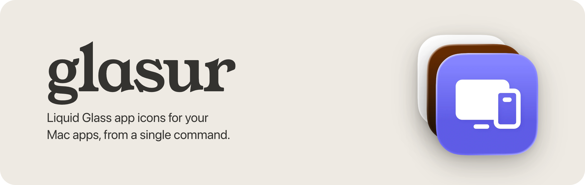
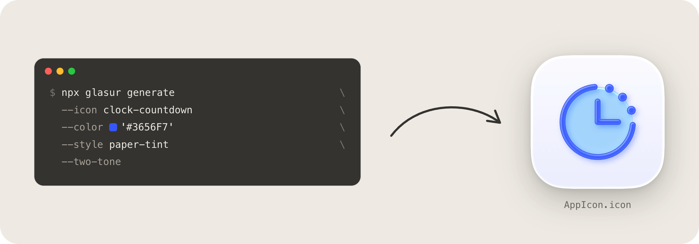

I find myself creating more and more small utility macOS apps and wanted an easy way for me (and my agents) to create icons that fit the macOS look without fiddling with Icon Composer.

Glasur turns a [Phosphor](https://phosphoricons.com) icon and an accent color into an editable, layered Liquid Glass Icon Composer `.icon` source. See it in action on the [website](https://geisterzeit.github.io/glasur/).



```sh
npx glasur generate --icon clock-countdown --color '#3656F7' --style paper-tint --two-tone
```

## Icons

`--icon` takes the name of any of the 1,512 [Phosphor icons](https://phosphoricons.com),
such as `sneaker-move`, `clock-countdown` or `gear-six`. Glasur uses the fill
weight and keeps it as vector artwork.

## Styles

Pick a style with `--style`. Each one derives its colors from `--color`.

### `default`


```sh
npx glasur generate --icon sneaker-move --color '#5E5CE6'
```

### `paper`


```sh
npx glasur generate --style paper --icon sneaker-move --color '#5E5CE6'
```

### `paper-tint`


```sh
npx glasur generate --style paper-tint --icon sneaker-move --color '#5E5CE6'
```

### `night`


```sh
npx glasur generate --style night --icon sneaker-move --color '#5E5CE6'
```

### `night-tint`


```sh
npx glasur generate --style night-tint --icon sneaker-move --color '#5E5CE6'
```

### Two tones

Add `--two-tone` to any style to use Phosphor's duotone version of the icon.


```sh
npx glasur generate --style paper --two-tone --icon clock-countdown --color '#3656F7'
```

## Output

Run glasur from your project's root folder. It saves the icon as
`AppIcon.icon`, the name Xcode uses for app icons by default:

| Your project | Where the icon goes |
| --- | --- |
| Xcode project with `MyApp/Assets.xcassets` | `MyApp/AppIcon.icon` |
| Swift package without an asset catalog | `Resources/AppIcon.icon` |

If your project has more than one `Assets.xcassets`, for example for an app and
a widget, choose the location yourself with `--output`:

```sh
npx glasur generate --icon devices --color '#5E5CE6' --output MyApp/AppIcon.icon
```

## License

glasur is available under the [MIT License](LICENSE). The
[Phosphor Icons](https://phosphoricons.com) it installs as a dependency are
© 2023 Phosphor Icons, also under the MIT License.
